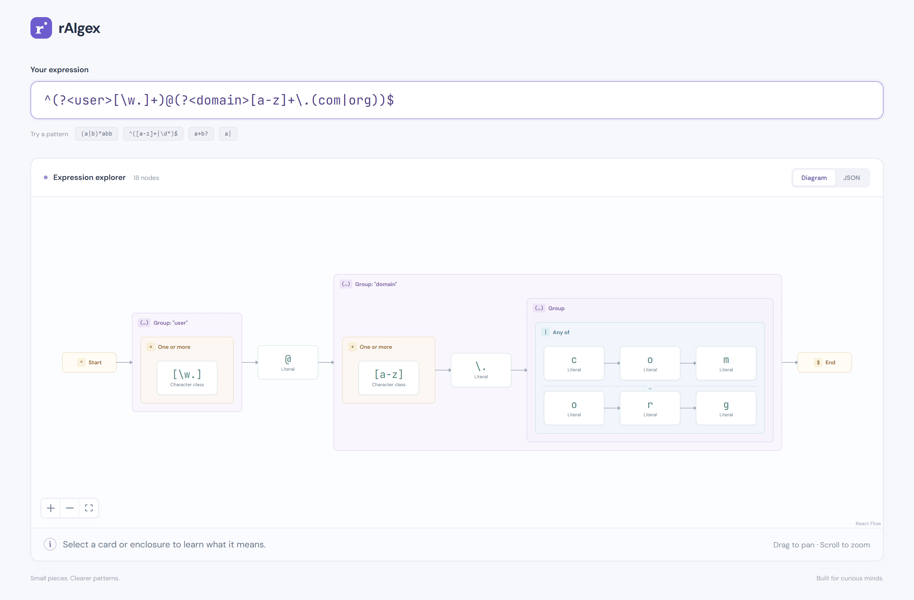

# rAIgex

An interactive regex explorer. Type a regular expression and rAIgex parses it with a hand-written recursive-descent parser, then renders it as a nested, pannable diagram (built with React Flow). Click any card or enclosure to see what that piece of the pattern means, or switch to the JSON view to inspect the raw AST.



*`^(?<user>[\w.]+)@(?<domain>[a-z]+\.(com|org))$`: named groups, character classes, quantifiers and alternation, all rendered as nested blocks.*

## Supported syntax

| Feature | Examples |
| --- | --- |
| Literals and escapes | `a`, `\.`, `\n`, `\t` |
| Wildcard and shorthand classes | `.`, `\d`, `\w`, `\s`, `\D`, `\W`, `\S` |
| Character classes | `[a-z]`, `[\w.]`, `[^0-9]` |
| Anchors | `^`, `$` |
| Groups | `(...)`, `(?<name>...)` |
| Quantifiers | `*`, `+`, `?`, `{m}`, `{m,}`, `{m,n}` |
| Alternation | `a\|b` |

Invalid patterns get an error message with a caret pointing at the offending position.

## Getting started

Requires Node.js 22.18 or newer, which runs the TypeScript tests directly.

```bash
npm install
```

```bash
npm run dev
```

Then open http://localhost:5173.
